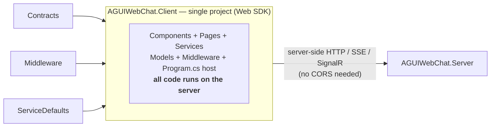
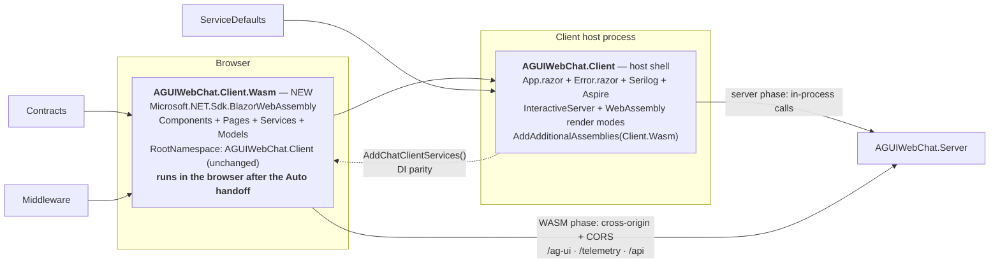
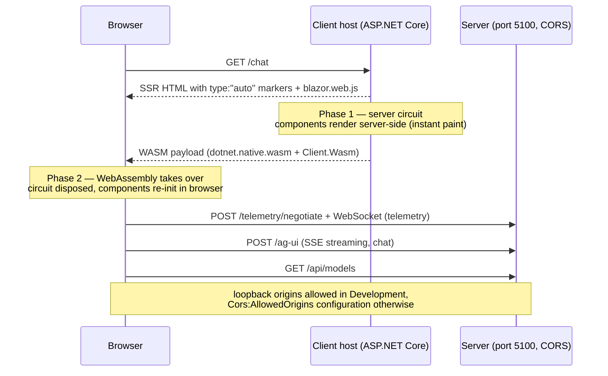
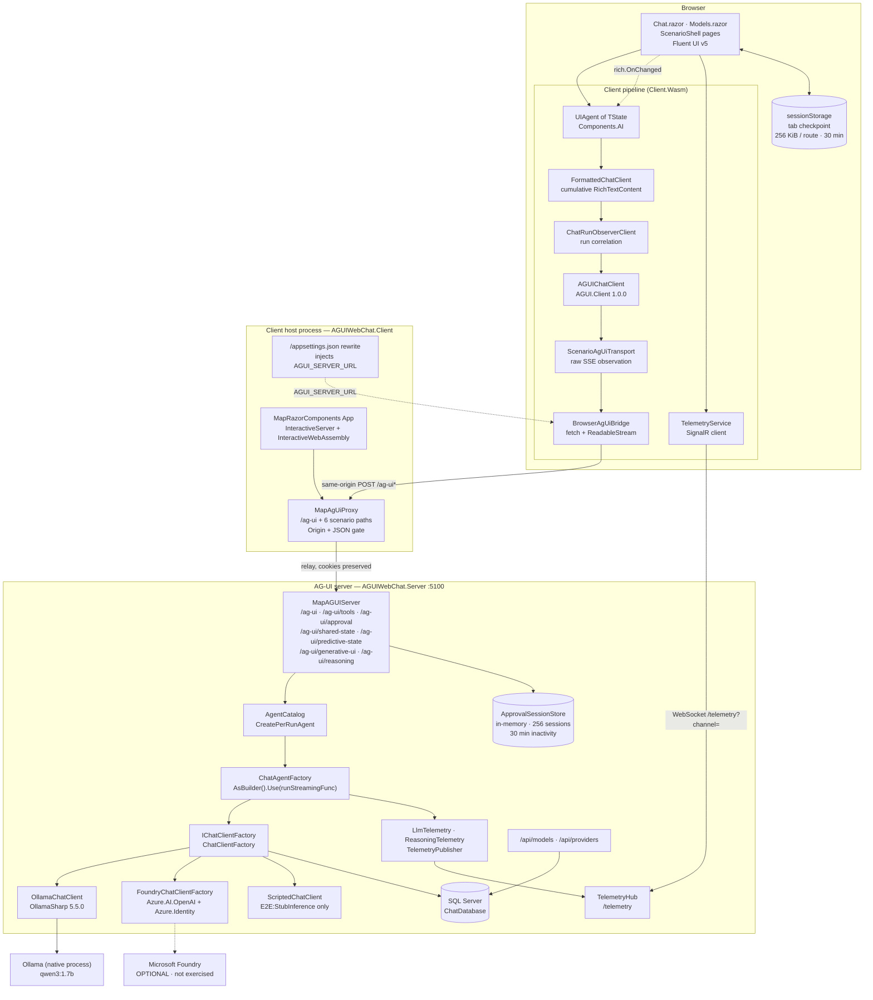
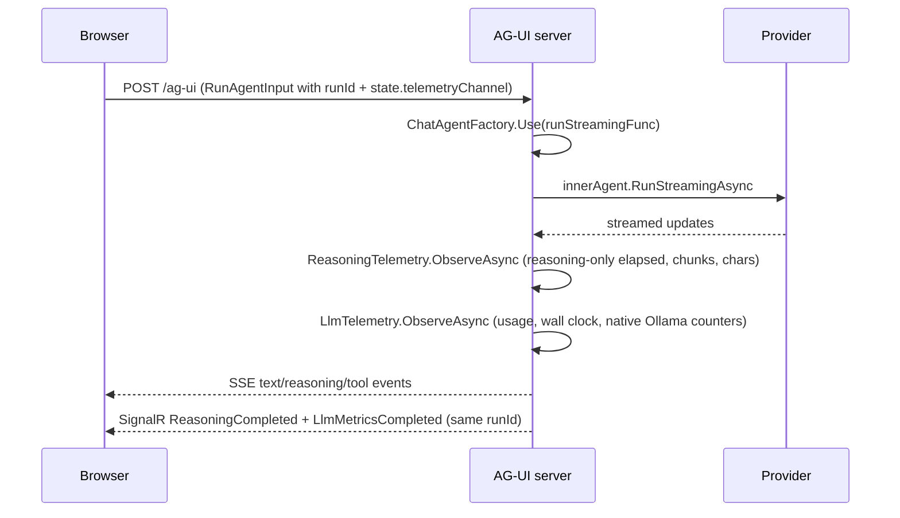

# AGUIWebChat — Architecture

> **Client hosting model: Blazor Web App with the `InteractiveAuto` render mode** (converted
> from pure Blazor Server). The interactive UI lives in the `AGUIWebChat.Client.Wasm`
> Blazor WebAssembly project and is served by the `AGUIWebChat.Client` host shell.

## Solution structure — before / after

**Before** — a single `Microsoft.NET.Sdk.Web` project hosted every component and service and
executed them all on the server (`@rendermode InteractiveServer`):



**After** — a thin server-side host plus a Blazor WebAssembly project carrying all
interactivity (`InteractiveAuto`):



## Interactive Auto lifecycle



## Behavioral changes at a glance

| Concern | Before (InteractiveServer) | After (InteractiveAuto) |
|---|---|---|
| Component execution | Always server, per-connection circuit | Server first, then **WebAssembly in the browser** |
| `Client.Wasm` project | — | Holds all interactive UI/services; host keeps only shell + error page |
| DI registrations | Single `Program.cs` | Shared `AddChatClientServices()` called by **both** `Program.cs` (server + WASM phases) |
| Server calls | In-process (host → server) | Browser → server, **cross-origin** — CORS policy `"BlazorClient"` on the Server |
| Chat service | `AgUiChatService` — `CreateSessionAsync().GetAwaiter().GetResult()` **deadlocks on WASM's single-threaded context** | `UiAgentChatService` — `UIAgent` over `AGUIChatClient`, fully async; the old type no longer exists |
| `NavMenu.razor` | `@rendermode InteractiveServer` (redundant) | Override removed — a hardcoded Server mode **crashes the WASM takeover** (`NotSupportedException`) |
| Failure fallback | — | If WASM can't load, the server circuit keeps serving |

Conventions worth remembering:

- The `RootNamespace` of `AGUIWebChat.Client.Wasm` is deliberately kept as
  `AGUIWebChat.Client` so every namespace, `@using` directive and test reference survived
  the split unchanged.
- `MapRazorComponents(...).AddAdditionalAssemblies(...)` resolves the WASM assembly through
  `ServiceCollectionExtensions` instead of the usual `typeof(_Imports)`, because both
  projects generate a `Components._Imports` type (CS0433 collision).
- Both `Program.cs` files call `AddChatClientServices(serverUrl)` so the server phase and
  the WebAssembly phase resolve identical services.

---

## Runtime pipeline (chat → agent → telemetry)

The main `/ag-ui` pipeline below is retained. `AgentCatalog` adds `/ag-ui/tools`,
`/ag-ui/approval`, `/ag-ui/shared-state`, `/ag-ui/predictive-state`,
`/ag-ui/generative-ui`, and `/ag-ui/reasoning`, selecting the provider per run through
`IChatClientFactory` and retaining the same inference/telemetry envelope.

Main chat also resolves the catalogue provider/model on every run. Its conversation model
picker affects only the next run and resets with New chat; it does not persist a global
model choice or modify catalogue rows. Omitting the selection uses the server's enabled
catalogue default, then its configured Foundry/Ollama fallback when the catalogue is empty.
`UiAgentChatService` supplies inference settings and the per-circuit telemetry channel in
`RunAgentInput.State`; the browser relay preserves that envelope in both actual renderers.
The server validates settings and drops unsupported provider-specific knobs.

Reasoning telemetry stays inside LLM telemetry. Each run publishes one reasoning summary
with accumulated reasoning-only elapsed time, chunk count and character count, regardless
of tracing listeners/sampling. LLM metrics include provider/model labels, generic
`UsageContent` token counts and wall-clock duration, plus Ollama's native eval/token/timing
counters when available. Model information (including provider) respects `ShowModelInfo`;
monitoring does not require reasoning output. Missing real RunId logs a warning and skips
publication. Delivery failure never replaces or interrupts the inference stream.

Only approval/predictive routes keep bounded, 30-minute inactivity-expiring MAF session
state, isolated by a server-issued caller cookie and conversation. They retain approval
binding, not durable transcripts. AG-UI owns request message history on these routes so
resumes do not duplicate stored approval calls. Fresh transport interrupt IDs prevent
provider-reused call IDs from authorizing a different proposal.

Document/plan snapshots preserve the state envelope; deltas are RFC 6902 arrays. Approved
model selection changes only `state.modelId` for the next run, never global catalogue state.
For exact DTO, resume, cookie/proxy, and error contracts, see
[Server scenario protocol](README.md#server-scenario-protocol-9). Browser/circuit cookie
continuity and Components.AI state/approval adapters remain #10 work.


## Component map

The diagram below reflects the merged source at `0ba486e`. It shows the two renderers
(Server circuit and WebAssembly), the single browser-side AG-UI transport, the
provider factory, the seven AG-UI endpoints, and the telemetry path.



### Responsibilities

| Layer | Owns | Does not own |
|---|---|---|
| Browser (`Client.Wasm`) | Rendering, `UIAgent` state, tab checkpoint, telemetry channel | Provider selection, tool execution, approval authority |
| Client host (`Client`) | SSR shell, render-mode selection, same-origin relay, `AGUI_SERVER_URL` injection | Chat logic, catalogue data |
| AG-UI server | Endpoint routing, agent construction, provider resolution, tool execution, approval binding, telemetry publication | UI state, browser storage |
| Provider | Token generation, native timing counters | Settings validation, telemetry |

### Durable, checkpoint and state boundaries

| Boundary | Lifetime | Contents |
|---|---|---|
| `sessionStorage` tab checkpoint | 30 min, 256 KiB per route | Route/version, thread ID, whole state, canonical history, typed presentation, pending tool/interrupt metadata |
| `ApprovalSessionStore` | 30 min inactivity, 256 sessions, 256 KiB each | MAF session state and pending approval binding, keyed by caller cookie + `threadId` + endpoint |
| SQL Server `ChatDatabase` | Durable | Provider and model catalogue rows only |
| Conversation history | Request-scoped | AG-UI owns request message history; no durable transcript or account exists |

There is no durable conversation store, no user account, and no server-side transcript.
A later WebAssembly visit restores a **new** `UIAgent` from the tab checkpoint without
re-executing old turns.

## Provider resolution

`ChatClientFactory` is scoped and resolves a provider per catalogue model on every run.
It branches on `ModelProviderKind`:

| Kind | Client | Endpoint resolution |
|---|---|---|
| `Ollama` (1) | `OllamaApiClient` via OllamaSharp 5.5.0 | `OLLAMA_ENDPOINT`, then `OLLAMA_HOST`, else throw |
| `Foundry` (2) | `AzureOpenAIClient` + `Azure.Identity` | `Foundry:Endpoint` / `FOUNDRY_URI`; must be absolute HTTPS |
| `Unknown` (0) | Rejected | — |

`E2E:StubInference=true` short-circuits the factory with `ScriptedChatClient` so E2E
assertions are exact and no provider is contacted.

`CreateDefaultAsync` supplies the startup agent metadata when the catalogue is empty. A
configured Foundry deployment wins over `OLLAMA_MODEL` (default `qwen3:1.7b`). An
Ollama-only deployment never contacts Azure: `FoundryOptions.IsConfigured` is false and
the Foundry branch is never taken.

## Telemetry flow



Reasoning telemetry stays inside LLM telemetry. Each run publishes one reasoning summary
regardless of tracing listeners or sampling. `TelemetryPublisher` skips publication when
the real `RunId` is missing, applies a 2-second delivery timeout, and logs a warning
instead of interrupting the inference stream. Metrics are not replayed after a
disconnect. The channel separates circuits; it is not authentication.

## Findings and limitations

### Reproduced in this repository

- `UIAgent` yields each content block once; later fragments arrive as change
  notifications, so `Chat.razor` subscribes to `rich.OnChanged(...)`.
- `ContentBlock.Id` has an internal setter, so identities cannot be assigned to
  externally emitted custom blocks. The app uses `BlockRenderer` presentation
  registrations over app-owned typed projections instead.
- `FormattedChatClient` must inject a cumulative `RichTextContent` snapshot per
  `MessageId`; a delta-only stream renders partial Markdown.
- `ChatBlockProjector.CombineNodes` dedupes `RichContentBlock` by reference and falls
  back to `MarkdownRichTextParser.Parse(block.RawText)`.
- `UIAgent<TState>` does not send state automatically; `UiAgentChatService.BuildState()`
  supplies it through `ChatOptions.RawRepresentationFactory`.
- Predictive state is not automatic either: the proposed document is rendered by
  `UIActionBlock` and only becomes real when the user accepts or rejects it, which routes
  through `ScenarioSession.DecideAsync(tool, approved)`.
- The pinned Components.AI package is `11.0.0-preview.7.26425.128`; preview APIs may
  change between builds.
- Real Ollama inference was exercised against a locally running `qwen3:1.7b` through
  `/ag-ui`, `/ag-ui/tools`, and `/ag-ui/reasoning`. Each run returned `RUN_FINISHED` with
  `outcome.type=success` and provider-reported usage, and emitted `gen_ai.provider.name:
  ollama` spans plus a `LLM completed` telemetry line. This proves the Ollama provider
  path end to end; it does not prove the Foundry path.
- A full-stack live smoke ran the AppHost with **SQL Server and real Ollama** (no
  `E2E:InMemoryDatabase`, no `E2E:StubInference`) and drove a real Chromium browser
  through eight scenarios. Seven passed: the `/models` catalogue page rendered the seeded
  `qwen3:1.7b` row with its capabilities, and six of the seven AG-UI routes streamed real
  model output — `/ag-ui`, `/ag-ui/tools`, `/ag-ui/shared-state`,
  `/ag-ui/predictive-state`, `/ag-ui/generative-ui`, and `/ag-ui/reasoning`. The eighth,
  `/ag-ui/approval`, is covered deterministically by the committed E2E suite (see the
  limitation below) but did not pass in this live run.
- `E2E:InMemoryDatabase=true` calls `EnsureCreated()`, which does not apply EF migrations.
  The seeded `qwen3:1.7b` catalogue row is therefore absent, `/api/models` returns `[]`,
  and every scenario route except `/ag-ui` and `/ag-ui/reasoning` rejects the run with
  "Select an enabled catalogue model with SupportsTools for this scenario." Create a
  catalogue model through `POST /api/models` before exercising those routes in-memory.
- **The AppHost does not apply schema or seed data.** A first `aspire start` against a
  fresh SQL Server container leaves the `server` resource failing its startup readiness
  check with exit code 134. Apply migrations before the server can start, then restart the
  resource:

  ```bash
  dotnet ef database update --project src/Server/AGUIWebChat.Server.csproj \
    --connection "Server=127.0.0.1,<port>;User ID=sa;Password=<password>;TrustServerCertificate=true;Initial Catalog=ChatDatabase;Encrypt=False"
  aspire resource <server-resource> start
  ```

  Since the startup readiness check was added (`DatabaseSanityCheck`, see
  `docs/README.md` → "Startup database readiness check"), the failure is reported as a
  `DATABASE READINESS: FAILED / status: SchemaMissing` block naming that exact
  `dotnet ef database update` command, instead of the bare
  `SqlException: Invalid object name 'AIModels'` that `ChatClientFactory.GetDefaultModelIdAsync`
  previously produced. `/health` returns the same block with `503 Unhealthy` while running.

  After the migrations are applied, the seeded `qwen3:1.7b` catalogue row, its defaults,
  and the three reasoning efforts are present and `/api/models` returns the full row.

### Historical observations

- The pre-merge client used a hand-rolled `AgUiChatService` agent/session loop with
  `CreateSessionAsync().GetAwaiter().GetResult()`, which deadlocks on WebAssembly's
  single-threaded context. `UiAgentChatService` replaced it. No `AgUiChatService` type
  remains in the solution.
- The original single-project Blazor Server layout is documented above under
  "Solution structure — before / after".

### Upstream reports — not verified here

These are open upstream issues, referenced for context only. This repository does not
reproduce or depend on their resolution:

- [dotnet/aspnetcore#69265](https://github.com/dotnet/aspnetcore/issues/69265) — add a
  finalization callback for active content block handlers.
- [dotnet/aspnetcore#69266](https://github.com/dotnet/aspnetcore/issues/69266) — allow
  custom handlers to replace structured `RichContentBlock` content.
- [dotnet/aspnetcore#68418](https://github.com/dotnet/aspnetcore/issues/68418) —
  implement the extensible rich-node renderer.

### Explicit limitations

- **Microsoft Foundry is optional and was not exercised.** The provider path is
  implemented and unit-tested, but no Azure deployment, role assignment, or paid call was
  performed. Do not read the presence of configuration keys as proof of a working
  deployment.
- **No durable conversation storage.** Tab checkpoints expire after 30 minutes and are
  per-browser-tab.
- **One stable thread ID per `UIAgent`.** A rejected predictive proposal can be
  re-proposed; the app does not suppress repeats.
- **SQL-backed smoke requires infrastructure.** The E2E suite uses
  `E2E:InMemoryDatabase=true` and `E2E:StubInference=true`, so it proves deterministic
  transport and UI contracts, not SQL Server migrations or real model inference. The
  separate real-inference smoke above used the in-memory catalogue, so it also does not
  prove SQL Server migrations. The full-stack live smoke did exercise SQL Server
  migrations and real inference, but it is a manual run, not part of CI.
- **Small local models are unreliable at tool calling.** `qwen3:1.7b` is the only model
  available in the reference environment, and it does not reliably emit the
  `switch_active_model` tool call that `/ag-ui/approval` requires. Across six direct
  requests to the live endpoint, four returned `RUN_FINISHED` with no tool call at all and
  two returned a single well-formed call. In one observed run the model emitted a second,
  malformed call whose arguments were `{"tool_call_id": "switch_active_model_1"}` instead
  of `{"modelId": 1}`. The client rejects that at `TOOL_CALL_END` through
  `ScenarioToolProjection.ValidateArguments`, which is deliberate: malformed pending
  arguments must fail before result validation, and
  `ScenarioToolProjectionTests.SemanticPendingArgumentsFailBeforeResultValidation` pins
  that behaviour. The rejection surfaces as the generic
  "The agent request could not be completed. Start a new conversation and request a fresh
  proposal." alert and clears the checkpoint. This is a model-capability limit, not a
  transport or contract defect — the server emits a correct single-interrupt
  `RUN_FINISHED` whenever the model produces one well-formed call. Use a larger
  tool-calling model for `/ag-ui/approval`, and rely on the committed E2E suite (which
  scripts the tool call deterministically) to verify the approval flow.
- **Preview packages.** `Microsoft.AspNetCore.Components.AI` and
  `Microsoft.Agents.AI.Hosting.AGUI.AspNetCore` are preview builds.
- **Known warnings, not suppressed.** `System.Security.Cryptography.Pkcs` 9.0.18 raises
  NU1902/NU1903, and `ApprovalSessions.cs` raises CS9124. Both are disclosed and
  deliberately not upgraded or suppressed in this change.
